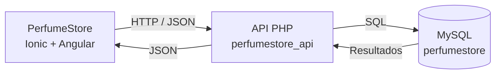

# Arquitectura Cliente-Servidor de PerfumeStore

## 1. Diagrama general



La aplicación Ionic funciona como cliente móvil. El cliente no accede directamente a MySQL: todas las operaciones pasan primero por la API PHP. La API valida la solicitud, ejecuta la operación correspondiente en la base de datos y responde al cliente utilizando JSON.

## 2. Endpoints utilizados

La ruta base se forma dinámicamente con el servidor capturado en el login:

`http://<servidor>:80/perfumestore_api/`

| Endpoint | Método | Uso |
|---|---|---|
| `index.php` | GET | Comprobar que la API está disponible. |
| `login.php` | POST | Validar usuario y contraseña. |
| `perfumes.php` | GET | Consultar perfumes o un perfume por `id`. |
| `perfumes.php` | POST | Registrar un perfume. |
| `perfumes.php?id={id}` | PATCH | Modificar un perfume. |
| `perfumes.php?id={id}` | DELETE | Eliminar un perfume. |
| `clientes.php` | GET | Consultar clientes o un cliente por `id`. |
| `clientes.php` | POST | Registrar un cliente. |
| `clientes.php?id={id}` | PATCH | Modificar un cliente. |
| `clientes.php?id={id}` | DELETE | Eliminar un cliente. |
| `ventas.php` | GET | Consultar ventas o una venta por `id`. |
| `ventas.php` | POST | Registrar una venta. |
| `ventas.php?id={id}` | PATCH | Modificar una venta. |
| `ventas.php?id={id}` | DELETE | Eliminar una venta. |

## 3. Métodos HTTP

- `GET`: consulta información sin modificarla.
- `POST`: crea nuevos registros o envía credenciales para autenticación.
- `PATCH`: modifica solo los datos enviados de un registro existente.
- `DELETE`: elimina un registro mediante su identificador.

## 4. Modelos JSON de intercambio

### Login enviado por el cliente

```json
{
  "usuario": "admin",
  "contrasena": "admin123"
}
```

### Perfume

```json
{
  "id": 1,
  "nombre": "Sauvage",
  "marca": "Dior",
  "tipo": "Eau de Parfum",
  "precio": 2500,
  "stock": 5
}
```

### Cliente

```json
{
  "id": 1,
  "nombre": "Daniel Bueno",
  "telefono": "6180000000",
  "correo": "cliente@ejemplo.com"
}
```

### Venta

```json
{
  "id": 1,
  "clienteId": 1,
  "perfumeId": 1,
  "cantidad": 2,
  "precioUnitario": 2500,
  "total": 5000,
  "fecha": "2026-10-26"
}
```

### Formato general de respuesta de la API

```json
{
  "success": true,
  "message": "Operación realizada correctamente.",
  "data": {}
}
```

Cuando existe un error de validación, la respuesta puede incluir además un objeto `errors`.

## 5. Servicios Angular

La comunicación se encuentra separada por servicios:

- `ConexionService`: guarda la dirección del servidor, comprueba `index.php` y realiza el login.
- `ApiService`: construye las peticiones HTTP y procesa el formato común de respuesta JSON.
- `PerfumeService`: utiliza `perfumes.php`.
- `ClienteService`: utiliza `clientes.php`.
- `VentaService`: utiliza `ventas.php`.
- `CacheService`: conserva la última respuesta correcta de perfumes, clientes y ventas para lectura temporal cuando la API no está disponible.

Los nombres de los endpoints están centralizados en `src/app/config/api-endpoints.ts` y los contratos JSON comunes se encuentran en `src/app/models/api.model.ts`.

## 6. Flujo de una operación

Ejemplo al consultar perfumes:

1. La vista solicita los datos a `PerfumeService`.
2. `PerfumeService` llama a `ApiService` usando `GET perfumes.php`.
3. `ApiService` obtiene la URL configurada desde `ConexionService`.
4. La petición HTTP llega a la API PHP.
5. PHP consulta MySQL.
6. La API devuelve el resultado como JSON.
7. Angular convierte la respuesta al modelo `Perfume[]` y la vista muestra los datos.
8. Si la consulta fue correcta, `CacheService` conserva una copia local para respaldo.

## 7. Alcance del proyecto entregado

Este repositorio contiene el cliente Ionic/Angular. La API PHP y la base de datos MySQL se ejecutan de forma local mediante XAMPP en la ruta `/perfumestore_api`, por lo que deben estar levantadas para probar operaciones contra MySQL.

## 8. Evidencia de IA

Para la entrega se puede agregar una captura de la conversación utilizada para revisar la arquitectura, identificar endpoints, separar responsabilidades entre servicios y validar los modelos JSON. La evidencia se incluirá en el documento final de la actividad.
