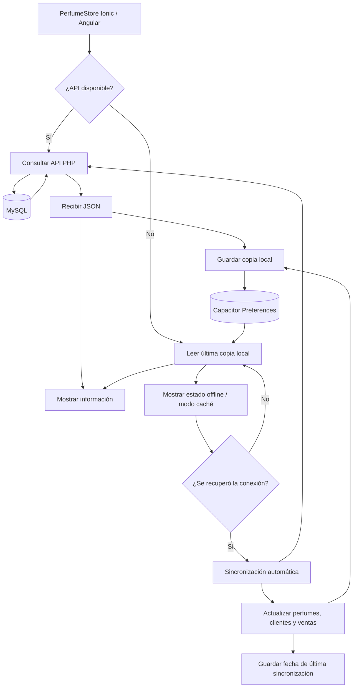

# Sincronización local-remota — PerfumeStore

Esta implementación integra la consulta remota mediante la API PHP con persistencia local mediante Capacitor Preferences.

## Puntos de la actividad cubiertos

| Requisito | Implementación |
| --- | --- |
| Persistencia local | `AlmacenamientoService` y `CacheService` guardan perfumes, clientes y ventas con Capacitor Preferences. |
| Consulta remota | `PerfumeService`, `ClienteService` y `VentaService` consultan la API PHP mediante `ApiService`. |
| Sincronización de información | `SincronizacionService` consulta los tres recursos directamente al servidor y reemplaza las copias locales. |
| Pérdida de Internet | Si una consulta remota falla, `CacheService.obtenerConRespaldo()` entrega la última copia local disponible. |
| Recuperación de conexión | `SincronizacionService` observa `EstadoConexionService` y sincroniza automáticamente cuando el estado vuelve a `conectado`. |
| Estado offline/online | La pantalla de Inicio muestra el estado de la API y el estado de sincronización. El banner global informa `SIN CONEXIÓN`, `SERVIDOR NO DISPONIBLE` o `MODO CACHÉ`. |
| Diagrama del proceso | Se incluye a continuación. |

## Diagrama del proceso

## Estrategia utilizada

La fuente principal continúa siendo MySQL. Cuando el servidor está disponible, PerfumeStore consulta los datos remotos y actualiza la copia local. Si se pierde Internet o la API deja de responder, las consultas pueden mostrar la última copia almacenada en el dispositivo. Las operaciones que modifican MySQL continúan requiriendo conexión para evitar registrar cambios falsos o conflictos.

Cuando la aplicación detecta que la API vuelve a estar disponible, `SincronizacionService` actualiza automáticamente las copias locales de perfumes, clientes y ventas y guarda la fecha de la última sincronización completada.
